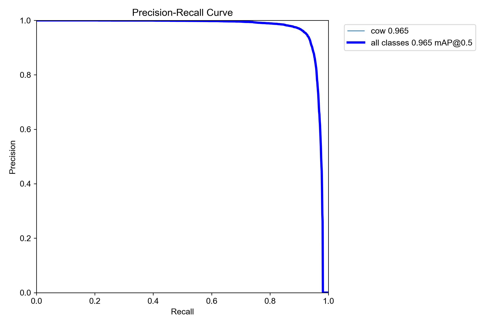

# 🐄 Cow Identifier

Find cows in drone photos, then work out **which cow is which** from their coat patterns.



It is a two-stage pipeline:

```
drone photo ──► 1. DETECT cows ──► crop each cow ──► 2. IDENTIFY ──► "Bella (0.81)"
                YOLOv8, tiled                          ResNet50 fingerprint
                trained on aerial data                 vs. your photo gallery
```

| Stage | What it does | Status |
|---|---|---|
| **1. Detection** | YOLOv8s fine-tuned on the public [WAID](https://github.com/xiaohuicui/WAID) aerial dataset (cattle only) | Trained and evaluated |
| **2. Identification** | Matches each detected cow to named reference cows using generic ResNet50 image features | **Experimental baseline** — see [Limitations](#limitations) |

## Detector results

Evaluated on the 932-image WAID validation split after a short 5-epoch fine-tune on CPU:

| Precision | Recall | mAP@0.5 | mAP@0.5:0.95 |
|:-:|:-:|:-:|:-:|
| 0.953 | 0.922 | 0.965 | 0.612 |

Full per-epoch numbers are in [`docs/training_results.csv`](docs/training_results.csv). These
numbers describe WAID imagery, **not yet your own fields** — keep some of
your own labelled photos as a separate test set (see `--my-data` below) to measure that honestly.

## Install

Python 3.10+.

```bash
git clone https://github.com/freshwatervic/cattle-detector-2026-v1.git
cd cattle-detector-2026-v1
python -m venv .venv && source .venv/bin/activate
pip install -e .                 # add ".[notebooks]" for Jupyter, ".[dev]" for tests
```

This installs five commands: `cow-prepare-data`, `cow-train`, `cow-detect`, `cow-reid`,
`cow-extract-frames`.

## Quick start (you already have trained weights)

1. Put the detector at `weights/best.pt` (download it from the repo's **Releases** page, or train
   it yourself below).
2. Add reference photos, one folder per cow. The folder name is the cow's name:
   ```
   looking_for/
       Bella/   bella1.jpg  bella2.jpg  bella3.jpg
       Greta/   greta1.jpg  greta2.jpg
   ```
3. Identify the cows in a drone photo:
   ```bash
   cow-reid --image photos/drone.jpg --out identified.jpg
   ```

Or follow the same steps interactively in [`notebooks/02_identify_cows.ipynb`](notebooks/02_identify_cows.ipynb).

**Reading the output.** Every cow gets a full ranking, e.g. `Bella:0.81  Greta:0.42  Heidi:0.39`.
What matters is the *gap* between 1st and 2nd place, not the raw number. A clear gap means it is
working; bunched scores (`0.71 / 0.70 / 0.68`) mean it is guessing. Use `--min-margin 0.05` (tune
it to your scores) to flag near-ties as `uncertain` instead of forcing a name.

## Train the detector yourself

```bash
git clone https://github.com/xiaohuicui/WAID.git          # public dataset, ~1.6 GB
cow-prepare-data --waid ./WAID --out ./dataset            # keeps cattle only, relabelled as "cow"
cow-train --data dataset/data.yaml --epochs 20            # add --device mps on Apple Silicon
cp runs/detect/cow_model/weights/best.pt weights/best.pt
```

To test on your own field, label some of your photos (e.g. in Roboflow, export as YOLOv8) and pass
them with `--my-data ./my_images`. They become the held-out test split.
[`notebooks/01_train_detector.ipynb`](notebooks/01_train_detector.ipynb) walks through the same steps.

## Other commands

```bash
cow-detect --source photo.jpg --out results/              # detection only, tiled
cow-detect --source flight.mp4 --frame-skip 5             # video, every 5th frame
cow-extract-frames --source flight.mp4 --every 1.0        # stills for labelling
```

## How it works

- **Tiled detection.** A 4000–5000 px drone frame fed to a 640 px model turns a cow into a few
  pixels. `cow-detect` cuts the frame into overlapping 640 px tiles, detects on each, maps the
  boxes back to full-frame coordinates and removes duplicates with NMS.
- **Aerial training data.** COCO-pretrained models have mostly seen animals from the side and call
  aerial cows "bear" or "dog". Fine-tuning on top-down WAID imagery fixes that.
- **Re-identification.** Each cow crop is turned into a 2048-number ResNet50 vector. A cow's
  reference photos are averaged into one vector; a detection is assigned to the reference with the
  highest cosine similarity.

## Limitations

- **Re-identification is not validated.** The fingerprint network is a generic ImageNet model, not
  trained on cows. It may not tell similar cows apart, particularly across the ground-photo vs
  top-down-drone gap. Treat the scores as evidence to inspect, not as ground truth.
- Reference photos should show the **back and upper sides** of each cow, the way the drone sees them.
- The detector was trained briefly (5 epochs) and on non-Swiss imagery; expect to fine-tune further
  on your own labelled data.
- Offline, post-flight processing only — not real-time on the drone.

## Roadmap

- Test re-identification on real labelled cows and report accuracy.
- Tiled detection inside `cow-reid` for very large images.
- Train a cow-specific embedding model on top-down crops.
- Thermal imagery support.

## Repository layout

```
cow_identifier/      the package (detection, training, data prep, re-identification)
notebooks/           step-by-step walkthroughs
tests/               pytest suite (runs without weights or a GPU)
docs/                training curves and metrics
weights/             put best.pt here (not committed)
looking_for/         your reference photos, one folder per cow (not committed)
photos/              your drone photos (not committed)
```

Run the tests with `pip install -e ".[dev]" && pytest`.

## Licensing and credits

- Detector: [Ultralytics YOLOv8](https://github.com/ultralytics/ultralytics) (AGPL-3.0). Weights
  fine-tuned from it are subject to the same terms.
- Training data: [WAID](https://github.com/xiaohuicui/WAID), *WAID: A Large-Scale Dataset for
  Wildlife Detection with Drones*, Applied Sciences 2023 — check its repository for usage terms.
- Fingerprints: ResNet50 with ImageNet weights from [torchvision](https://pytorch.org/vision/).
